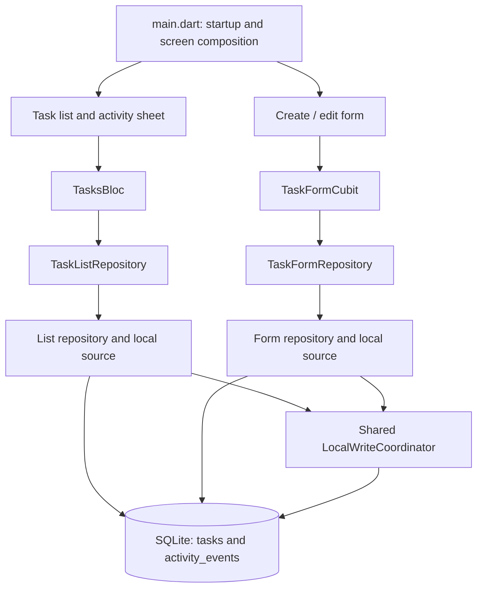

# Design

## Boundaries and alternatives

The app has two screen-owned features, `task_list` and `task_form`. Each contains
domain values and repository contracts, a local data implementation, and its
presentation state owner. Shared database opening, schema, write coordination,
dependency registration, and colors live in `core`. SQL rows stay in the data
layer; widgets consume immutable domain values and state.

An early alternative was one entity-oriented task feature containing both
screens. That avoids duplicate priority enums and some mapping. I chose
screen-oriented features to make the list's read/mutation responsibilities and
the form's save responsibilities explicit.
neither feature imports the other's presentation layer. Pass-through use cases
were omitted because there is no additional domain policy to justify them.

Drift was considered for typed queries, generated models, and migration tooling.
For two tables, `sqflite` keeps transactions visible without a generation step,
trading compile-time query checking for less tooling. `get_it` registers shared
resources; the composition root constructs screen state owners.

## Architecture

The queue orders writes; each local source owns its SQL transaction. List/history
reads await the queue's currently pending work, then query the database directly.

`TaskListQuery` carries title, priority, and completion criteria through the
repository contract without exposing SQL to presentation. The local source
combines active criteria with parameterized `AND` predicates. Title search uses
`LIKE`, escaping `%`, `_`, and the escape character so user input is treated
literally.

`TaskListResult` contains the matching tasks and an unfiltered `totalCount`.
The filtered query and `COUNT(*)` run in one read transaction, giving both values
a consistent snapshot. Only matching task rows are loaded into presentation;
the total count preserves the badge and distinguishes no tasks from no matches.

## Model and atomic writes

| Table | Stored fields |
| --- | --- |
| `tasks` | Integer auto-increment `id`, nonblank `title`, nullable `description`, `priority` (`low`/`medium`/`high`), `is_completed` (0/1), `created_at` |
| `activity_events` | Integer auto-increment `id`, `task_id`, event `type`, nullable `old_value`/`new_value`, `occurred_at` |

Times are UTC epoch microseconds, displayed in local time. Activity is queried by
`occurred_at ASC, id ASC`, with an index on `(task_id, occurred_at, id)`. Priority
events store old/new priorities. Text-only edits add no activity because those
events were not requested. This is not event sourcing: the task row is authoritative.

Every local mutation uses the shared coordinator. A form edit normalizes
whitespace and empty descriptions, reads persisted values within that queue, and
returns before opening a transaction if nothing changed. Otherwise, the task
update and any priority event execute in one transaction. Creation inserts the
task and its creation event together. Completion reads the current flag inside
the transaction, flips it, and inserts the corresponding transition. Any thrown
error rolls back the entire transaction.

Foreign keys are enabled on every database open. Deleting a task permanently
deletes its activity through `ON DELETE CASCADE` in the same transaction; a failed
delete restores both. Schema version is **1**. No historical migration is needed
yet; unsupported upgrades throw instead of silently discarding data. Future
schema changes must increment the version and add explicit migrations.

## State and concurrency

`TasksBloc` owns the current query and filters, database query results, total
task count, list loading/failure states, and selected activity with its loading
status. Every criteria change starts an asynchronous repository query. Previous
rows are cleared when criteria change so results from an older query are not
shown under the new criteria.

Each list request captures its criteria and receives an increasing request ID.
Only the latest request may publish results or errors; older database operations
may finish, but their responses are ignored. Activity loading uses a separate
request counter. Reloads after mutations and retries use the current criteria,
preserving search and filters.

The BLoC queues toggles, deletes, and retries together. The data-layer queue also
protects writes from both features, including form preflight reads. Rapid toggles
therefore inspect successive persisted states and produce alternating completion
events. A queued retry is skipped if a newer successful operation superseded its
failure. Coordination assumes one app-owned connection/coordinator; it is not a
multi-process locking protocol.

`TaskFormCubit` owns the immutable draft and initial/saving/success/failure status.
It validates titles and rejects overlapping saves; draft edits are ignored during
saving. On success the form returns and the existing list BLoC reloads. On failure
the draft remains available for another Save. A Cubit fits this single save flow
without adding another event hierarchy.

Selectors and `buildWhen` limit rebuilds by form status/priority, filter values,
task count, list content, or activity. Widgets dispose controllers, `BlocProvider`
closes state owners, and root disposal resets registrations, waits for queued
writes, and closes the database.

## Failures and evidence

`FAIL_WRITES=true` throws after the task mutation and before commit, including
between task and history inserts. It exercises rollback rather than rejecting
requests before touching SQLite. The list makes no optimistic task changes:
failure reloads stored data, retains criteria, and exposes an error plus Retry.
Read failure retains the previous snapshot when available. Form input remains an
unsaved draft, not persisted task state. Startup database failures also offer retry.

The 29 passing tests cover real file-backed SQLite reopen/rollback, an actual
history-insert error, no-op writes, rapid toggles, cross-feature writes, retries,
and duplicate saves. Query tests verify combined SQL criteria, literal wildcard
characters, Persian titles, deterministic ordering, and total counts. BLoC tests
verify criteria preservation and rejection of stale results and errors.

## Future server sync — design only

Add remote data sources in the features' data layer, for example under
`data/services/remote`. Repository implementations would coordinate local
and remote sources, keeping networking details out of widgets and state
owners.

Before implementation, agree on the product requirements: whether the app
must remain fully usable offline, which operations require server
confirmation, and when synchronization should run. These requirements
would guide the choice between local-first and online-first behavior.

If the current offline capability must be preserved, a local-first approach
would be a suitable option: save changes locally, synchronize when connected,
and retain pending changes if synchronization fails.

Also define how retries, conflicts, and deletions work across devices.
If sync progress or errors need to be visible, expose them through the
BLoC/Cubit without exposing networking details.
